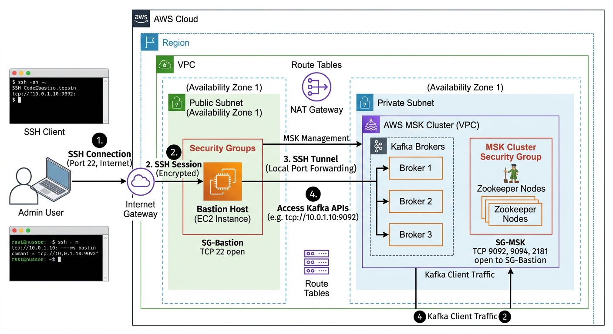

# Setting up Kafka on AWS

This contains an overview of setting up Apache Kafka on Amazon's MSK (Managed Service for Kafka)
Here is what the overall architecture looks like. To connect to Amazon's Kafka broker, 
we will need an EC2 instance that's called a "bastion host". That's where the jar file for your application will run.
You can set up port forwarding so that you can run Kafdrop or publish messages to the MSK brokers from your laptop, 
using a local IP address, and it will get forwarded to the actual MSK broker in Kafka. To do this, we will also need 
to set up the right IAM role policies and permissions, both locally and on the EC2 bastion host.



## Creating an MSK cluster

Once you log in to AWS, if you go to MSK
1. Create cluster
2. Choose "Quick create" (so you do not have to go through additional pages)
3. Enter a name for your cluster
4. Choose "Provisioned" (so we have some control over the broker size)
5. Pick standard brokers (no need for express)
6. Scroll down to Metadata mode and pick Zookeeper (this will allow for smaller clusters)
7. Scroll up and for the broker size, pick Kafka t3.small (no need for the larger ones)
8. The kafka version has to stay at 3.9, as newer versions will not support Zookeeper
9. Pick 5 GB for the Storage. Though you can't decrease it, you can always increase it later.
10. Click "Create Cluster" and Amazon will start setting it up.
11. After about 45 minutes, your cluster should be provisioned and running.

## Keeping AWS session going

Periodically, you may be logged out of AWS, so you may need to refresh your credentials

```
aws login
eval "$(aws configure export-credentials --profile default --format env)"

```

## Setting up the Bastion host

This script will take care of creating a new EC2 instance (Bastion host) and setting up the access from your machine to the bastion host, 
as well as from the Bastion host to Kafka. 
Because the EC2 instance does not have anything installed, the first time you ssh to it, java will be installed.

```
#Run this
./startBastion.sh your-cluster-name
#Follow the steps shown at the end of it
#Note the KAFKA_BROKERS_ALL variable - you will need this elsewhere

#Next set up permissions on the EC2 instance
./bastionPermissions.sh your-cluster-name

```

## Stopping the Bastion host

```
#Run this
./stopBastion.sh your-cluster-name
#You may have to run the last 2 steps manually to cleanup

```

## Running Kafdrop

Clone the Kafdrop fork: [https://github.com/v-tadipatri/kafdrop](https://github.com/v-tadipatri/kafdrop)
There's a kafka.properties file, which you will have to rename when running locally without IAM

## Publishing to Kafka

To publish to AWS MSK you need to be using a Java application that can handle IAM authentication.
As mentioned in the output from startBastion.sh, you will need the local msk-iam.properties and the aws-msk-iam-auth jar file
With the scripts downloaded from the Kafka website:

```
aws sts get-caller-identity
export KAFKA_BROKERS_ALL=<see_output>
#This produces to an input_txn topic with no key
./bin/kafka-console-producer.sh --bootstrap-server $KAFKA_BROKERS_ALL  --command-config msk-iam.properties --topic input_txn < data/kafka_transactions.csv
#This produces to an input_cust topic with the 1st csv value as the key
./bin/kafka-console-producer.sh --bootstrap-server $KAFKA_BROKERS_ALL  --command-config msk-iam.properties --topic input_cust --property "parse.key=true"  --property "key.separator=," < data/kafka_customers.csv

```

